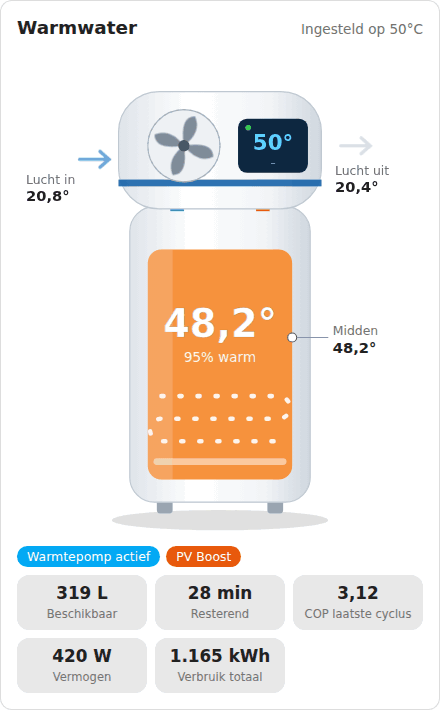
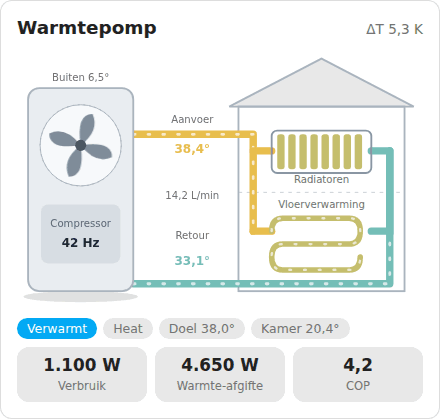

# Heat Pump Cards for Home Assistant

🇳🇱 [Nederlandse versie](README.md)

Two animated dashboard cards for Home Assistant:

| Card | Type | For |
| --- | --- | --- |
| **Atlantic Explorer V5** | `custom:atlantic-explorer-card` | Atlantic Explorer V5 heat pump water heater |
| **Panasonic monoblock** | `custom:panasonic-monoblock-card` | Panasonic monoblock heat pump without a buffer tank |

The fan spins, water flows, and the pipes and tank change colour with temperature. Card labels are in Dutch. Animations stop automatically if your device has "reduce motion" enabled.

<p align="center"> <picture> <source media="(prefers-color-scheme: dark)" srcset="images/boiler-dark.gif">  </picture> </p> <p align="center"> <picture> <source media="(prefers-color-scheme: dark)" srcset="images/monoblock-dark.gif">  </picture> </p> <p align="center">*Example with demo values. In Home Assistant the fan and water flow animate with the live status.*</p>

The idea comes from [AMensink/warmtepomp-cards](https://github.com/AMensink/warmtepomp-cards) (MIT). These cards were rebuilt from scratch for different devices.

---

## Installation

### Via HACS (recommended)

1. Open **HACS** in Home Assistant.
2. Click ⋮ in the top right → **Custom repositories**.
3. Paste the URL of this repository, choose type **Dashboard** and click **Add**.
4. Search for **Warmtepomp Cards**, click **Download** and reload the browser (Ctrl+F5).

### Manual

1. Download the file from the `dist/` folder and place it in `/config/www/`.
2. Go to **Settings → Dashboards → ⋮ → Resources → Add resource**.
3. URL: `/local/<filename>.js`, type: **JavaScript module**.
4. Reload the browser.

> If you also have the original `warmtepomp-cards` by AMensink installed, you can leave it in place. The card names are different, so they do not conflict.

---

## Usage

Edit a dashboard, choose **Add card**, open the card's YAML editor and fill in your own entities under `entities:`. Anything you leave out is omitted or shown as `–`. Click a value in the card to open that entity's details dialog.

---

## Atlantic Explorer V5

A white tank with the heat pump module on top. The tank colour follows the water temperature, the fan spins when the heat pump is active and the electric element glows when it is on. The display shows the target temperature and the mode.

```yaml
type: custom:atlantic-explorer-card
title: Warmwater
min_temp: 15
max_temp: 60
entities:
  tank_temp: sensor.explorer_midden_temp
  setpoint: sensor.explorer_target
  air_in: sensor.explorer_inlaat_temp
  air_out: sensor.explorer_uitblaas_temp
  power: sensor.explorer_vermogen
  energy_total: sensor.explorer_verbruik_totaal
  cop: sensor.explorer_cop_laatste_cyclus
  available_liters: sensor.explorer_38c_geschat
  remaining_minutes: sensor.explorer_38c_resterend
  pv_boost: switch.wpboiler_pv_boost
```

### Options

| Option | Description | Default |
| --- | --- | --- |
| `title` | Card title | `Warmwater` |
| `min_temp` | Temperature that counts as "cold" (colour and percentage) | `15` |
| `max_temp` | Temperature that counts as "hot" | `60` |

### Entities

| Key | Meaning |
| --- | --- |
| `water_heater` | `water_heater` entity (e.g. via Overkiz/Cozytouch). Used for temperature, target and mode when the separate sensors are missing |
| `tank_temp` | Water temperature in the middle of the tank |
| `tank_top` / `tank_bottom` | Top and bottom of the tank, if you have those sensors |
| `setpoint` | Target temperature |
| `air_in` / `air_out` | Air temperature before and after the evaporator |
| `power` | Electrical power (W) |
| `energy_today` / `energy_total` | Energy used today / in total (kWh) |
| `cop` | COP of the last cycle |
| `available_liters` | Available hot water (L) |
| `remaining_minutes` | Remaining shower time (min) |
| `pv_boost` | Switch for boosting on solar power |
| `compressor` | Heat pump active on/off. Without it, "active" is derived from power (> 50 W) |
| `heater` | Electric element on/off |
| `boost` / `away` | Boost and away mode |
| `mode` | Mode (Eco+, Manual, Programmed) |
| `fault` | Fault indicator |

---

## Panasonic monoblock

An outdoor unit with fan and compressor, connected to radiators and underfloor heating. No buffer tank is drawn: the supply line goes straight to the circuits. Power consumption, heat output and COP are shown at the bottom.

```yaml
type: custom:panasonic-monoblock-card
title: Warmtepomp
entities:
  supply: sensor.panasonic_main_outlet_temp
  return: sensor.panasonic_main_inlet_temp
  flow: sensor.panasonic_pump_flow
  power: sensor.panasonic_heat_power_consumption
  heat_power: sensor.panasonic_heat_power_production
  comp_hz: sensor.panasonic_compressor_freq
  ambient: sensor.panasonic_outside_temp
  defrost: binary_sensor.panasonic_defrosting_state
  setpoint: sensor.panasonic_main_target_temp
  thermostat: climate.woonkamer
```

### Options

| Option | Description | Default |
| --- | --- | --- |
| `title` | Card title | `Warmtepomp` |
| `show_radiators` | Show the radiator circuit | `true` |
| `show_floor` | Show underfloor heating | `true` |

### Entities

| Key | Meaning |
| --- | --- |
| `supply` / `return` | Supply and return water temperature |
| `flow` | Water flow rate (L/min) |
| `power` | Electrical power (W) |
| `heat_power` | Delivered heat output (W). Without it, the card estimates it from flow and ΔT |
| `comp_hz` | Compressor frequency (sets the fan's rotation speed) |
| `compressor` | Compressor on/off, if there is no frequency sensor |
| `ambient` | Outdoor temperature |
| `defrost` | Defrost on/off |
| `fault` | Fault code (0 = no fault) |
| `mode` | Operating mode |
| `setpoint` | Target supply temperature |
| `thermostat` | `climate` entity, shows the room temperature |
| `floor_pump` / `radiator_pump` | Pump switch. If it is off, that circuit turns grey |
| `energy_today` | Energy used today (kWh) |

---

## Good to know

- The monoblock COP is an estimate unless you provide `heat_power`: flow × 4.186 × ΔT divided by electrical power.
- The Atlantic's "heat pump active" state is derived from power if you do not provide a `compressor` sensor.
- An entity that does not exist is silently skipped. If a value stays empty, check that the entity ID is correct.

## License

MIT
