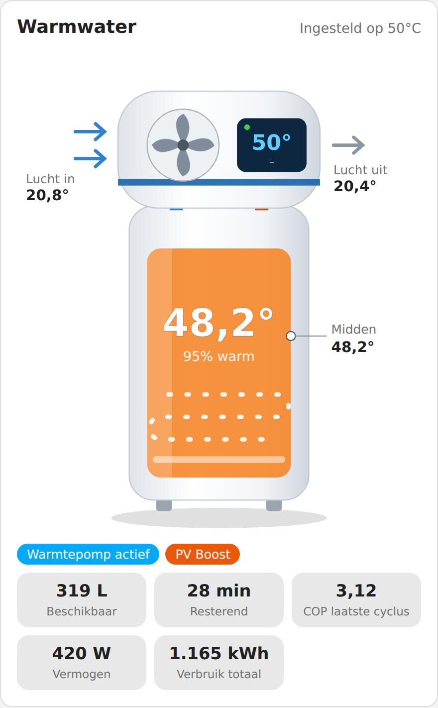
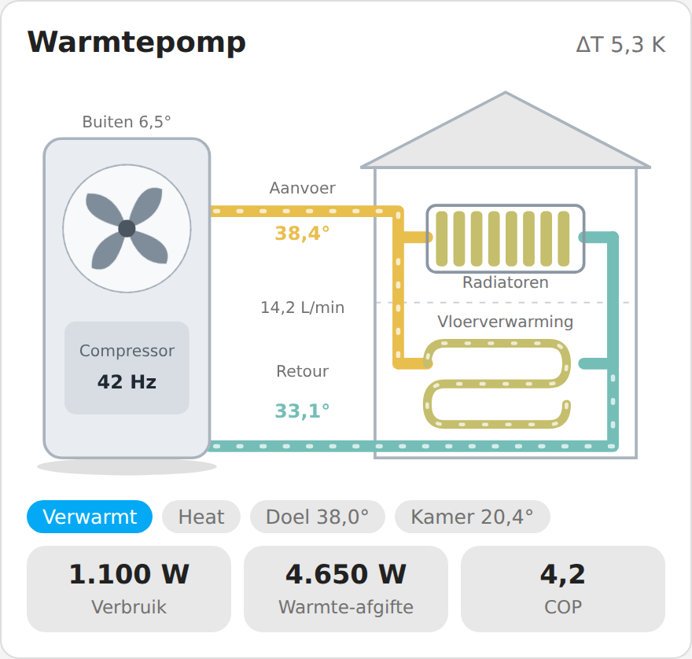

# Warmtepomp Cards voor Home Assistant

🇬🇧 [English version](README.en.md)

Twee geanimeerde dashboardkaarten voor Home Assistant:

| Kaart | Type | Voor |
| --- | --- | --- |
| **Atlantic Explorer V5** | `custom:atlantic-explorer-card` | Warmtepompboiler Atlantic Explorer V5 |
| **Panasonic monoblock** | `custom:panasonic-monoblock-card` | Panasonic monoblock-warmtepomp zonder buffervat |

De ventilator draait, het water stroomt en de leidingen en de tank kleuren mee met de temperatuur. Alle labels zijn in het Nederlands. Animaties stoppen automatisch als je apparaat "verminderde beweging" heeft ingesteld.

<p align="center">
  <picture>
    <source media="(prefers-color-scheme: dark)" srcset="images/boiler-dark.png">
    
  </picture>
</p>
<p align="center">
  <picture>
    <source media="(prefers-color-scheme: dark)" srcset="images/monoblock-dark.png">
    
  </picture>
</p>

<p align="center">*Voorbeeld met demowaarden. In Home Assistant bewegen de ventilator en de waterstroom mee met de live status.*</p>

Het idee komt van [AMensink/warmtepomp-cards](https://github.com/AMensink/warmtepomp-cards) (MIT). Deze kaarten zijn opnieuw opgebouwd voor andere apparaten.

---

## Installatie

### Via HACS (aanbevolen)

1. Open **HACS** in Home Assistant.
2. Klik rechtsboven op ⋮ → **Aangepaste repositories**.
3. Plak de URL van deze repository, kies type **Dashboard** en klik **Toevoegen**.
4. Zoek **Warmtepomp Cards**, klik **Downloaden** en herlaad de browser (Ctrl+F5).

### Handmatig

1. Download het bestand uit de map `dist/` en zet het in `/config/www/`.
2. Ga naar **Instellingen → Dashboards → ⋮ → Resources → Resource toevoegen**.
3. URL: `/local/<bestandsnaam>.js`, type: **JavaScript-module**.
4. Herlaad de browser.

> Heb je de originele `warmtepomp-cards` van AMensink ook staan? Verwijder die resource dan niet nodig: de kaartnamen zijn anders en ze storen elkaar niet.

---

## Gebruik

Bewerk een dashboard, kies **Kaart toevoegen**, open de YAML-editor van de kaart en vul je eigen entiteiten in onder `entities:`. Alles wat je niet invult, wordt weggelaten of als `–` getoond. Klik in de kaart op een waarde om het detailvenster van die entiteit te openen.

---

## Atlantic Explorer V5

Een witte tank met de warmtepompmodule bovenop. De tank kleurt mee met de watertemperatuur, de ventilator draait als de warmtepomp actief is en het elektrische element gloeit als het aan staat. Het display toont de ingestelde temperatuur en de modus.

```yaml
type: custom:atlantic-explorer-card
title: Warmwater
min_temp: 15
max_temp: 60
entities:
  tank_temp: sensor.explorer_midden_temp
  setpoint: sensor.explorer_target
  air_in: sensor.explorer_inlaat_temp
  air_out: sensor.explorer_uitblaas_temp
  power: sensor.explorer_vermogen
  energy_total: sensor.explorer_verbruik_totaal
  cop: sensor.explorer_cop_laatste_cyclus
  available_liters: sensor.explorer_38c_geschat
  remaining_minutes: sensor.explorer_38c_resterend
  pv_boost: switch.wpboiler_pv_boost
```

### Opties

| Optie | Omschrijving | Standaard |
| --- | --- | --- |
| `title` | Titel van de kaart | `Warmwater` |
| `min_temp` | Temperatuur die als "koud" geldt (kleur en percentage) | `15` |
| `max_temp` | Temperatuur die als "heet" geldt | `60` |

### Entiteiten

| Sleutel | Betekenis |
| --- | --- |
| `water_heater` | `water_heater`-entiteit (bijv. via Overkiz/Cozytouch). Wordt gebruikt voor temperatuur, instelwaarde en modus als de losse sensoren ontbreken |
| `tank_temp` | Watertemperatuur in het midden van de tank |
| `tank_top` / `tank_bottom` | Boven- en onderkant van de tank, als je die sensoren hebt |
| `setpoint` | Gewenste temperatuur |
| `air_in` / `air_out` | Luchttemperatuur voor en na de verdamper |
| `power` | Elektrisch vermogen (W) |
| `energy_today` / `energy_total` | Verbruik vandaag / totaal (kWh) |
| `cop` | COP van de laatste cyclus |
| `available_liters` | Beschikbaar warm water (L) |
| `remaining_minutes` | Resterende douchetijd (min) |
| `pv_boost` | Schakelaar voor boost op zonne-energie |
| `compressor` | Warmtepomp actief aan/uit. Zonder deze sensor wordt "actief" afgeleid uit het vermogen (> 50 W) |
| `heater` | Elektrisch element aan/uit |
| `boost` / `away` | Boost- en afwezigheidsstand |
| `mode` | Modus (Eco+, Handmatig, Programma) |
| `fault` | Storingsindicatie |

---

## Panasonic monoblock

Buitenunit met ventilator en compressor, gekoppeld aan radiatoren en vloerverwarming. Er is geen buffervat getekend: de aanvoer gaat rechtstreeks naar de circuits. Onderaan staan verbruik, warmte-afgifte en COP.

```yaml
type: custom:panasonic-monoblock-card
title: Warmtepomp
entities:
  supply: sensor.panasonic_main_outlet_temp
  return: sensor.panasonic_main_inlet_temp
  flow: sensor.panasonic_pump_flow
  power: sensor.panasonic_heat_power_consumption
  heat_power: sensor.panasonic_heat_power_production
  comp_hz: sensor.panasonic_compressor_freq
  ambient: sensor.panasonic_outside_temp
  defrost: binary_sensor.panasonic_defrosting_state
  setpoint: sensor.panasonic_main_target_temp
  thermostat: climate.woonkamer
```

### Opties

| Optie | Omschrijving | Standaard |
| --- | --- | --- |
| `title` | Titel van de kaart | `Warmtepomp` |
| `show_radiators` | Radiatorcircuit tonen | `true` |
| `show_floor` | Vloerverwarming tonen | `true` |

### Entiteiten

| Sleutel | Betekenis |
| --- | --- |
| `supply` / `return` | Aanvoer- en retourtemperatuur |
| `flow` | Waterdebiet (L/min) |
| `power` | Elektrisch vermogen (W) |
| `heat_power` | Geleverd warmtevermogen (W). Zonder deze sensor schat de kaart het uit debiet en ΔT |
| `comp_hz` | Compressorfrequentie (bepaalt de draaisnelheid van de ventilator) |
| `compressor` | Compressor aan/uit, als er geen frequentie is |
| `ambient` | Buitentemperatuur |
| `defrost` | Ontdooien aan/uit |
| `fault` | Storingscode (0 = geen storing) |
| `mode` | Bedrijfsmodus |
| `setpoint` | Gewenste aanvoertemperatuur |
| `thermostat` | `climate`-entiteit, toont de kamertemperatuur |
| `floor_pump` / `radiator_pump` | Schakelaar van de pomp. Staat die uit, dan wordt het circuit grijs |
| `energy_today` | Verbruik vandaag (kWh) |

---

## Goed om te weten

- De COP van de monoblock is een schatting als je geen `heat_power` opgeeft: debiet × 4,186 × ΔT gedeeld door het elektrisch vermogen.
- De "Warmtepomp actief"-status van de Atlantic wordt afgeleid uit het vermogen als je geen `compressor`-sensor opgeeft.
- Een entiteit die niet bestaat, wordt stilletjes overgeslagen. Controleer bij een lege waarde of de entiteit-ID klopt.

## Licentie

MIT
